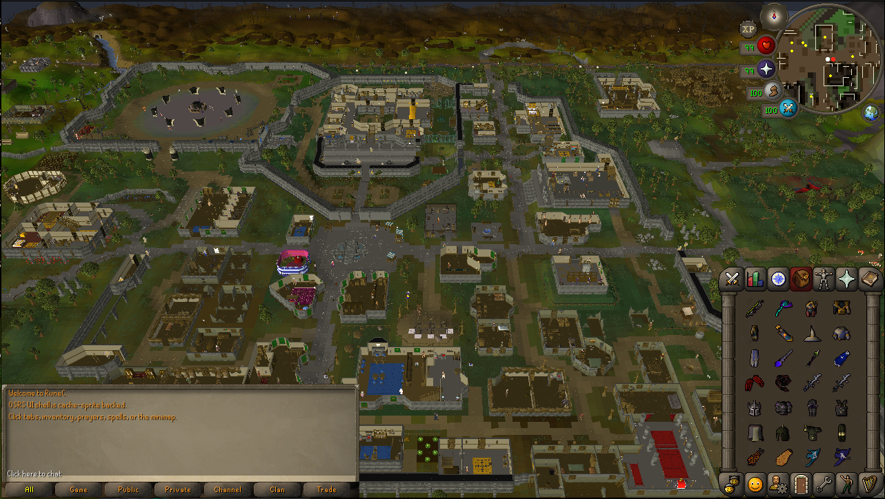
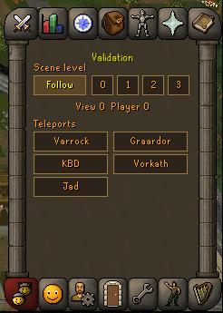
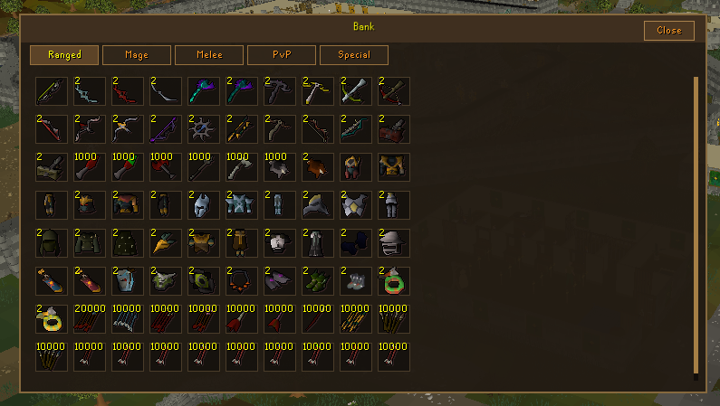

# RuneC

RuneC is a local C implementation of Old School RuneScape-style gameplay. It
currently runs as a playable desktop viewer and uses the same backend for
deterministic headless simulation.

The goal is simple: make an OSRS-like game that can be played locally, tested
quickly, and reused for fast simulation workloads without needing a live server.

## Features

RuneC currently includes:

- a playable local world slice with cache-backed terrain, objects, collision,
  models, textures, sprites, fonts, animations, and NPC spawns
- an OSRS-style fixed gameframe with inventory, equipment, combat styles,
  prayer, spellbook, chatbox, minimap, orbs, tabs, and context menus
- click-to-walk, right-click camera panning, middle-click context menus, and a
  top-left hover label showing the current left-click action
- doors, gates, ladders, stairs, caves, portals, manholes, object transports,
  and plane changes for tested areas
- player, NPC, equipment, projectile, object, and item rendering from the local
  cache/data pipeline
- inventory, equipment, bank/storage, spell selection, rune checks, ranged and
  magic projectile foundations, and combat validation helpers
- a modular C backend intended for both playable runs and fast headless
  simulation

## Dependencies

The current clone-and-run path is tested on Linux.

On Ubuntu/Debian:

```bash
sudo apt update
sudo apt install git build-essential cmake python3 curl zlib1g-dev libgl1-mesa-dev
```

You also need Bash, `sha256sum`, and a working desktop/OpenGL environment to
run the Raylib viewer. Raylib itself is vendored in `lib/raylib/`, so normal
builds do not require a separate Raylib install.

## Quick Start

```bash
git clone --branch dev https://github.com/jordanbailey00/RuneC-Testing.git
cd RuneC-Testing
RUNEC_DATA_MANIFEST_URL=https://github.com/jordanbailey00/RuneC-Testing/releases/download/data-v2026.10.22-b237/manifest.json ./scripts/setup-data.sh
cmake -S . -B build -DCMAKE_BUILD_TYPE=RelWithDebInfo
cmake --build build --parallel
./build/rc-viewer
```

Run these commands from your checkout root; the directory name is not fixed.
After moving or renaming an existing checkout, regenerate CMake's local build
metadata (`cmake --fresh -S . -B build -DCMAKE_BUILD_TYPE=RelWithDebInfo` with
CMake 3.24+, or configure a new build directory), then rebuild. Do not copy
another machine's `build/` directory. Source paths are derived at configure/run
time, and OpenGL is discovered through CMake rather than a distro-specific path.

This Testing branch pins its own data release on `RuneC-Testing` through
`runtime-data.lock`; it does not change the live `RuneC` repository or releases.
The command above explicitly opts into this Testing prerelease. Setup verifies
the locked manifest checksum and every pack, then installs them into the local
ignored `data/` directory. Plain setup intentionally refuses automatic download
while the official release gate is blocked.
Maintainer/dev checkouts can still generate `dist-data/` locally and install
from it with `--offline dist-data`.
The pinned `data-v2026.10.22-b237` release includes the complete four-plane
world, updated loot definitions, per-item ground models and the encounter
data (ENCT v15 encounters with Vorkath anchored, boss combat visuals, the
runtime spawned-loc templates and unscaled NPC models with their scale
table). Commits `7e323b6` onwards need it; `28f37c8` to `2113bf8` pair with
`data-v2026.10.21-b237` and earlier commits with `data-v2026.10.03-b237`.
Unverified loot tables remain explicitly rejected; this release is not full
gameplay parity.
The official release gate still flags unfinished loot, unavailable prayer
effects, and an outdated gathering-count report. Runtime tests passing does not
resolve those content/reporting gaps. No installer or gameplay logic changed.

## Validation Tools

RuneC includes temporary in-game validation tools so combat, movement, planes,
and asset rendering can be tested without running across the world.



Open the Clan Chat side tab to use the validation panel:

- `Follow` returns the scene view to the player's current plane.
- `0`, `1`, `2`, and `3` force the viewer to inspect a specific scene level.
- `Varrock`, `Graardor`, `KBD`, `KQ` (Kalphite Queen), `Chaos Ele` (Chaos
  Elemental), `Vorkath`, and `Jad` move the player to common validation locations. Vorkath
  arrives asleep; Poke it to start the fight. Teleporting there again puts it back to sleep.
- `CoX`, `ToB`, `ToA` and `Archive` move the player beside the raid entrance
  of Chambers of Xeric, Theatre of Blood, Tombs of Amascut and The Fractured
  Archive. Entering moves the player into the raid's map (the cache's static
  template of it); each raid also has one exit back to its lobby or hub. Raid
  bosses, puzzles and rewards are not implemented yet, so the rooms are empty.
  The Fractured Archive exists only in b241 data; without b241 map data its
  teleport is blocked with a chat message.

These helpers are for development and testing. To run without them:

```bash
RUNEC_DEV_VALIDATION=0 ./build/rc-viewer
```

You can also start directly at a validation destination:

```bash
RUNEC_DEV_TRANSPORT_DEST=graardor ./build/rc-viewer
```

## Validation Bank

The Varrock bank is seeded with high-level gear and supplies for combat testing.



The bank is split into simple testing tabs:

- `Ranged`
- `Mage`
- `Melee`
- `PvP`
- `Special`

It includes weapons, armor, ammunition, runes, capes, offhands, jewelry, and
other items used to validate combat animations, projectiles, equipment models,
special attacks, and item behavior. Stackable supplies are loaded in bulk, and
withdrawals leave one copy behind so the bank order stays stable while testing.

The Varrock-bank combat dummy is also temporary validation content. Disable just
the dummy with:

```bash
RUNEC_DEV_BANK_DUMMY=0 ./build/rc-viewer
```

## Current Status

RuneC is still in active development. The current build is good for local
exploration, UI validation, combat visual testing, object/transport testing,
and backend regression work. Some game systems and content are still incomplete,
including full combat parity, all special attacks, full boss behavior, exact
minimap marker/icon parity, and long-tail item/object edge cases.

## Repository Layout

```text
rc-core/       Headless C game engine. Tick loop, pathfinding, combat,
               inventory, equipment, objects, traversal, data loading, and
               subsystem state. No rendering or OSRS-specific content.

rc-content/    OSRS-specific content hooks. Boss scripts, quest state machines,
               and region-specific behavior that sits on top of rc-core.

rc-viewer/     Raylib frontend. Rendering, camera, input translation, UI,
               animation playback, and presentation-only state.

tools/         Python data tooling for packing, unpacking, validating, and
               exporting runtime assets.

tests/         C runtime tests, regression tests, and benchmark helpers.

data/          Local runtime data install populated by scripts/setup-data.sh.
               This directory is ignored by Git.
```

## Data Setup

RuneC does not track generated runtime data in Git. Run this once after cloning:

```bash
RUNEC_DATA_MANIFEST_URL=https://github.com/jordanbailey00/RuneC-Testing/releases/download/data-v2026.10.22-b237/manifest.json ./scripts/setup-data.sh
```

This installs:

```text
data/
  manifest.json
  packs/
    *.pak
  defs/
  models/
  regions/
  sprites/
  fonts/
  ui/
```

Official locks allow automatic downloads; this non-official Testing lock
requires the explicit command above. Use `--offline dist-data` for
maintainer-built local packs. The script expands packs into loose local runtime
files so the viewer uses the fast file-loading path. Set
`RUNEC_DATA_UNPACK=0` to keep only the manifest and packs, or
`RUNEC_DATA_UNPACK_FORCE=1` to rewrite already extracted files.

When upgrading an existing install, keep the previous `data/` directory as a
backup and run the explicit Testing command above into a new, empty `data/`
directory. Do not mix `.pak` files from different releases: duplicate logical
assets are rejected. The previous release remains available for use with its
matching code revision.
Maintainers package existing validated runtime files with
`python3 tools/pack_runtime_data.py`; normal users do not need raw cache inputs
or local asset exports.

Runtime asset loading supports both loose files and release packs. The default
backend is `auto`: loose `data/...` files are used when present, otherwise
`data/packs/*.pak` is used. Override with `RUNEC_ASSET_BACKEND=loose` or
`RUNEC_ASSET_BACKEND=pack`. Runtime startup validates `data/manifest.json`
before creating a world and reports missing required data paths as startup
errors.

Data maintainers can export cache-backed visual assets by mapsquare and plane
for a named or radius-based region set:

```bash
export RUNEC_B237_CACHE=/path/to/b237/cache
python3 tools/data_pipeline.py export-regions --region-set varrock
python3 tools/data_pipeline.py export-regions --region-set edgeville
python3 tools/data_pipeline.py export-regions --center-x 3213 --center-y 3428 --radius-regions 2
python3 tools/data_pipeline.py export-regions --full
```

`RUNEC_REGION_SET` accepts `varrock`, `edgeville`,
`around:<x>,<y>,r=<radius>`, or `full` when running
`export-cache-derived-assets`. `full` is a maintainer build selection; local
development should use a named or radius-based set. Full exports use bounded
parallel worker batches by default; set `RUNEC_REGION_EXPORT_JOBS` to a
positive worker count when release-machine resources require a different cap.

A production runtime-data build must export the full catalog before packing:

```bash
export RUNEC_B237_CACHE=/path/to/b237/cache
export RUNEC_B237_DUMP=/path/to/b237/dump
python3 tools/data_pipeline.py all --full --version v1
```

The production packer rejects missing mapsquare planes or animated-object
sidecars. `--allow-partial-mapsquares` exists only for explicit development
packs; `data_pipeline.py` applies it automatically for non-`full` region sets.

Split exports use deterministic paths such as `regions/50_53.p0.terrain`,
`regions/50_53.p0.objects`, `regions/50_53.p0.oanim`, and
`regions/50_53.p0.minimap.png`. Object chunks and
animated object model sidecars share `regions/mapsquare.materials.atlas` and
`regions/mapsquare.materials.tanim`; they do not copy an atlas per chunk.
`regions/mapsquare.catalog` records every mapsquare with authoritative b237
terrain. Sparse dungeon/destination windows load every catalog-listed chunk
while excluding cache-index voids; a missing file for a listed mapsquare still
blocks activation.
Terrain color blending, lighting normals, corner heights, and contoured object
placement sample a one-mapsquare cache halo in every direction. Each split
terrain file stores a complete `65x65` corner-height grid for its `64x64` tile
area, so independently exported neighbors retain continuous edges.
Minimap rasters use the cache's floor shapes, visual-plane rules, walls, doors,
and mapscene sprites. The viewer streams them with the matching visual chunk,
rotates the map/markers/click transform with the camera, and retains a coarse
terrain fallback for runtime-data packs built before minimap rasters existed.
Aggregate scene slices remain available only as a development compatibility
cache through `tools/cache_pipeline/export_scene_slice.py --output-prefix ...`.
They and `data/regions/scene_cache/` are excluded from runtime-data packs.

When the complete starting visual window is present, the viewer uses a bounded,
center-first mapsquare cache. A worker performs installed-asset reads, pack
decompression, binary parsing, and CPU mesh preparation for terrain, static
objects, animated objects, shared materials, and filtered NPC models. The
render thread performs budgeted GPU uploads and commits only after every
visible chunk and required NPC model succeeds. Core independently commits the
authoritative active area before a player crosses a mapsquare or relocates.
Moving the visual window retains overlap; cancellation, missing assets, or
decode/upload failure leaves the prior scene active without moving the backend
player backward. Normal gameplay never launches Python or reads
the source cache. Maintainers can opt into bounded development generation with
`RUNEC_SCENE_AUTO_EXPORT=1`; an incomplete or failed split export still blocks
the transition instead of launching aggregate generation.
Object traversals now use one generation-owned core transaction. Content
admits an exact source, one explicitly resolved destination, a presentation
class, and phase timing; core retains that identity through approach,
takeoff/transit, checked relocation, landing, cancellation, and one terminal
outcome. Destination simulation activates before coordinates change. The
viewer consumes the read-only core event to prefetch and present the selected
destination, discards stale visual generations, and never selects or rewrites
gameplay coordinates.
PR 11 adds frontend-only latency hiding rather than a loading screen.
Route/direction lookahead warms one visual window ahead of an ordinary
boundary, and admitted object traversals prefetch the core-selected destination
while the player routes and the authored action runs. Matching work is promoted
without restarting it. PR 10 transaction safety still protects late or failed
visual preparation. The superseded progress overlay and broad loading input
gate have been removed. See the [archived streaming plan](docs/archive/full_world_streaming_plan-through-2026-10-03.md)
for acceptance history and [TODO.md](docs/TODO.md) for remaining work.
Height sampling also clamps the outer corner of legacy `64x64` terrain files;
new exports carry the actual neighboring corner values.

`RUNEC_MAPSQUARE_STREAMING=0` disables the mapsquare path.
`RUNEC_MAPSQUARE_DIR` selects another mapsquare directory, and
`RUNEC_PLAYER_START_PLANE` selects the startup plane. Existing viewer radius
and CPU/GPU chunk-cap settings bound the mapsquare plan.

Headless environments can verify viewer startup without opening a window:

```bash
RUNEC_VIEWER_SMOKE=1 RUNEC_ASSET_BACKEND=pack ./build/rc-viewer
RUNEC_VIEWER_SMOKE=1 RUNEC_ASSET_BACKEND=loose ./build/rc-viewer
RUNEC_VIEWER_SMOKE=1 RUNEC_VIEWER_SMOKE_MAPSQUARES=1 ./build/rc-viewer
```

## Build

Build out of tree:

```bash
cmake -S . -B build -DCMAKE_BUILD_TYPE=RelWithDebInfo
cmake --build build --parallel
```

Run the viewer:

```bash
./build/rc-viewer
```

Run tests:

```bash
ctest --test-dir build --output-on-failure
```

Data maintainers can rebuild release packs from loose `data/` with:

```bash
./tools/pack_runtime_data.py --dry-run --version v1
./tools/pack_runtime_data.py --version v1 --output dist-data --force
```

Run the SPS benchmark:

```bash
bash tests/benchmarks/run_sps_benchmark.sh
```

Use `--mode magic` or `--mode ranged` for sustained spell/ammunition payment
workloads, for example `--envs 32 --steps 200000 --warmup 2000`. These modes
use installed item/spell definitions and content hooks and fail if attacks or
resource consumption stop. They measure headless throughput, not viewer FPS.

## Engine API

`rc-core` exposes a small C API centered on world creation, queued player
intent, and deterministic ticks:

```c
RcWorldConfig cfg = rc_preset_combat_only();
RcWorld *world = rc_world_create_config(&cfg);

rc_player_walk_to(world, 3222, 3218);
rc_world_tick(world);

rc_world_destroy(world);
```

Useful presets:

```c
rc_preset_full_game();      // all gameplay systems
rc_preset_combat_only();    // movement + combat-focused simulation
rc_preset_skilling_only();  // movement + inventory/equipment + skills
rc_preset_base_only();      // minimal movement/tick baseline
```

## Architecture Boundaries

- `rc-core` owns gameplay state and rules.
- `rc-content` owns OSRS-specific content hooks and scripts.
- `rc-viewer` owns rendering, UI presentation, camera, animation playback, and
  input-intent translation.
- `tools/` owns export-time cache/data conversion and runtime pack creation.
- `data/` is local-only runtime/data-factory output.

Gameplay rules should not live in the viewer. Cache decoding should not happen
inside the runtime tick path. Generated data should not be committed to the
RuneC repository.

## References

RuneC uses local reference checkouts for audit and parity research. The runtime
does not call those projects.

- [OpenRS2](https://archive.openrs2.org/) for OSRS cache archives
- [RuneLite](https://github.com/runelite/runelite) for cache/client behavior
  reference
- [RSMod](https://github.com/rsmod/rsmod) for OSRS server behavior reference
- [OSRS Wiki](https://oldschool.runescape.wiki/) for content facts and
  mechanics

Private-server and wrong-game sources are not accepted as RuneC data
authority. Missing facts should be tracked as source gaps until backed by the
b237 cache/dumps, RuneLite, RSMod, OSRS Wiki, or reviewed authored content.

## License

RuneC is for educational and research purposes. Old School RuneScape content,
cache data, names, and assets belong to Jagex Ltd.
